# PetShop API

API RESTful para gestão de um pet shop, construída com **C# .NET 10**, **ASP.NET Core Minimal APIs** (sem Controllers) e **Entity Framework Core**, com acesso a dados 100% assíncrono (`async`/`await`).

## Integrantes

- Mariana Neugebauer Dourado - RM550494
- Victor Pacifico Dias - RM558017
- Gustavo Ruiz Vieira Paulino - RM554779
- Guilherme Abe - RM554743

## Contexto do projeto

Pequenos pet shops e clínicas veterinárias costumam controlar clientes, animais e serviços em planilhas ou cadernos, o que gera perda de informação e conflitos de horário.

Esta API centraliza esse controle: cadastra **tutores**, os **pets** de cada tutor e os **agendamentos** de serviços (banho, tosa, consulta, vacina), aplicando regras de negócio como impedir dois serviços no mesmo horário para o mesmo pet. Destina-se a donos e atendentes de pet shops, e pode servir de back-end para um sistema web ou aplicativo.

## Banco de dados

**SQLite** (arquivo `petshop.db`, criado automaticamente na pasta `PetShopApi`).

## Tecnologias

- .NET 10 / ASP.NET Core Minimal APIs
- Entity Framework Core 10 (SQLite) com Migrations
- OpenAPI nativo + Swagger UI como interface de documentação/testes

## Como rodar localmente

Pré-requisitos: [.NET 10 SDK](https://dotnet.microsoft.com/download) e a ferramenta `dotnet-ef`.

```bash
dotnet tool install --global dotnet-ef
git clone https://github.com/NeugeMa/petshop-api.git
cd petshop-api/PetShopApi
dotnet ef database update
dotnet run
```

- `dotnet ef database update` aplica as migrations e cria o `petshop.db`. (A API também aplica migrations pendentes ao iniciar, então rodar `dotnet run` direto também funciona.)
- Abra a URL exibida no console (ex.: `http://localhost:5xxx`). A raiz `/` redireciona para a documentação interativa (Swagger UI) em **`/swagger`**. O documento OpenAPI fica em `/openapi/v1.json`.

## Modelo de dados

```
Tutor 1 ──── N Pet 1 ──── N Agendamento
```

| Entidade | Campos |
|---|---|
| Tutor | Id, Nome, Email (único), Telefone |
| Pet | Id, Nome, Especie, Raca?, DataNascimento?, TutorId |
| Agendamento | Id, PetId, DataHora, Servico (`Banho`, `Tosa`, `BanhoETosa`, `Consulta`, `Vacina`), Valor, Status (`Agendado`, `Concluido`, `Cancelado`) |

## Endpoints

### Tutores
| Método | Rota | Descrição | Respostas |
|---|---|---|---|
| GET | `/tutores` | Lista tutores | 200 |
| GET | `/tutores/{id}` | Busca por id | 200, 404 |
| GET | `/tutores/{id}/pets` | Lista os pets do tutor | 200, 404 |
| POST | `/tutores` | Cadastra tutor | 201, 400, 409 (e-mail duplicado) |
| PUT | `/tutores/{id}` | Atualiza tutor | 200, 400, 404, 409 |
| DELETE | `/tutores/{id}` | Remove tutor | 204, 404, 409 (possui pets) |

### Pets
| Método | Rota | Descrição | Respostas |
|---|---|---|---|
| GET | `/pets` | Lista pets | 200 |
| GET | `/pets/{id}` | Busca por id | 200, 404 |
| GET | `/pets/{id}/agendamentos` | Lista agendamentos do pet | 200, 404 |
| POST | `/pets` | Cadastra pet | 201, 400, 404 (tutor inexistente) |
| PUT | `/pets/{id}` | Atualiza pet | 200, 400, 404 |
| DELETE | `/pets/{id}` | Remove pet | 204, 404, 409 (possui agendamentos) |

### Agendamentos
| Método | Rota | Descrição | Respostas |
|---|---|---|---|
| GET | `/agendamentos` | Lista agendamentos | 200 |
| GET | `/agendamentos/{id}` | Busca por id | 200, 404 |
| POST | `/agendamentos` | Agenda um serviço | 201, 400, 404 (pet inexistente), 409 (horário ocupado) |
| PUT | `/agendamentos/{id}` | Atualiza (inclusive o status) | 200, 400, 404, 409 |
| DELETE | `/agendamentos/{id}` | Remove agendamento | 204, 404 |

### Exemplos de corpo (JSON)

```json
// POST /tutores
{ "nome": "Ana Souza", "email": "ana@email.com", "telefone": "11999999999" }

// POST /pets
{ "nome": "Rex", "especie": "Cachorro", "raca": "Labrador", "dataNascimento": "2020-05-01", "tutorId": 1 }

// POST /agendamentos
{ "petId": 1, "dataHora": "2030-01-01T10:00:00", "servico": "Banho", "valor": 50.00 }
```

## Regras de negócio e tratamento de erros

- Campos obrigatórios, e-mail válido e limites de tamanho/valor → **400** com detalhes por campo (`ValidationProblem`).
- Não cadastrar pet para tutor inexistente, nem agendar para pet inexistente → **404**.
- E-mail de tutor único → **409**.
- Não agendar no passado → **400**.
- Um pet não pode ter dois agendamentos ativos no mesmo horário → **409**.
- Não excluir tutor com pets, nem pet com agendamentos → **409**.
- Erros não tratados retornam `ProblemDetails` padronizado (500).

## Evidências de teste

Prints dos endpoints funcionando, testados pelo Swagger UI (`/swagger`). Os arquivos ficam na pasta [`assets`](assets).

### Tutores

**POST `/tutores`** — cadastra tutor (201)

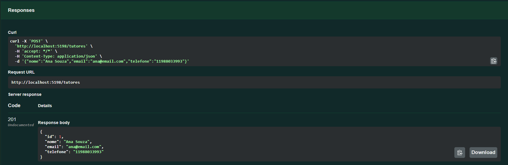

**POST `/tutores`** — cadastra um segundo tutor (201)

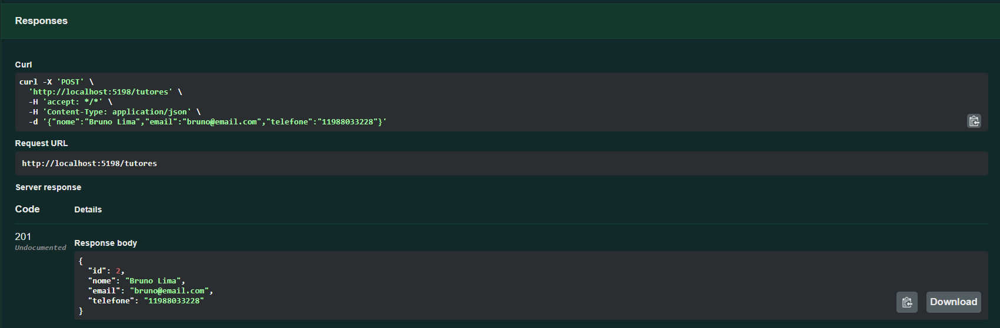

**GET `/tutores`** — lista tutores (200)

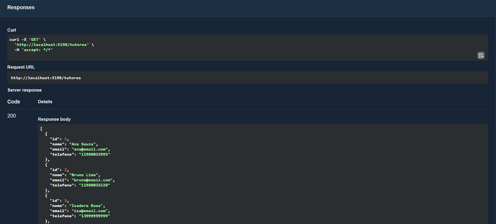

**GET `/tutores/{id}`** — busca tutor por id (200)

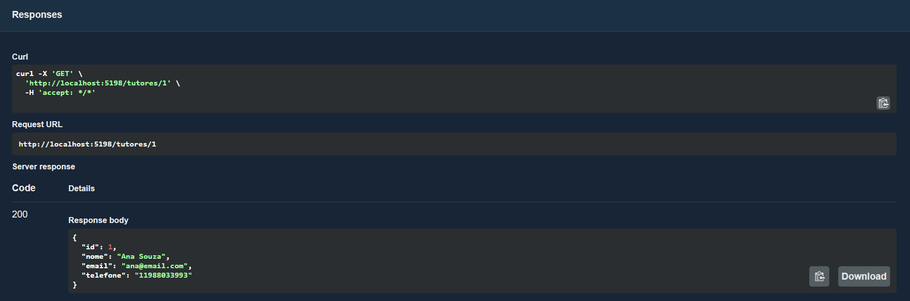

**PUT `/tutores/{id}`** — atualiza tutor (200)

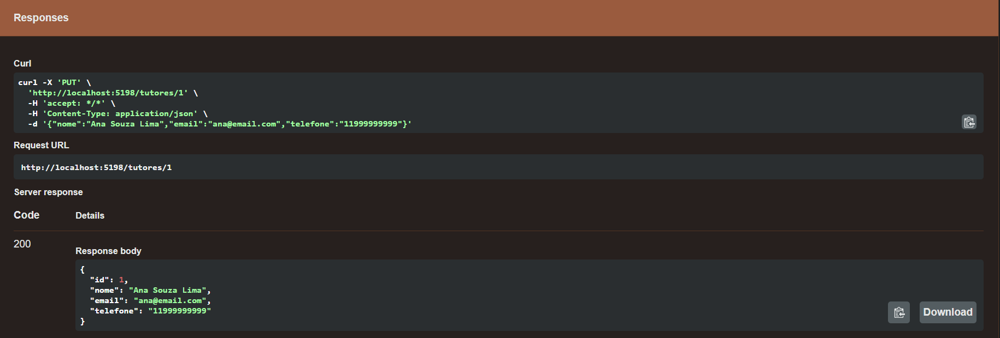

**GET `/tutores/{id}/pets`** — lista os pets de um tutor (200)

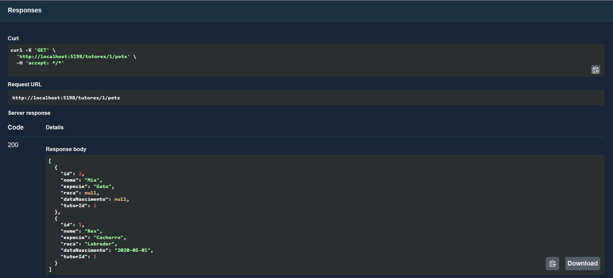

**DELETE `/tutores/{id}`** — remove tutor sem pets (204)

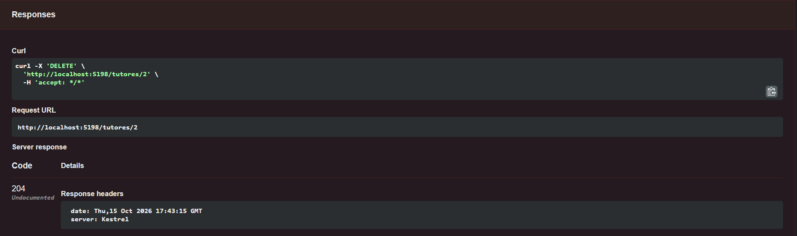

### Pets

**POST `/pets`** — cadastra pet (201)

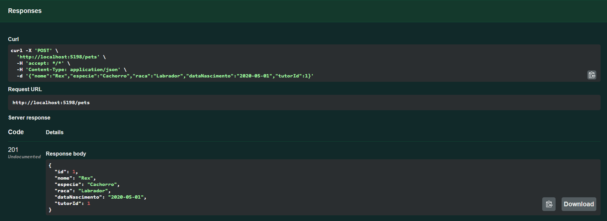

**POST `/pets`** — cadastra um segundo pet, sem raça nem data de nascimento (201)

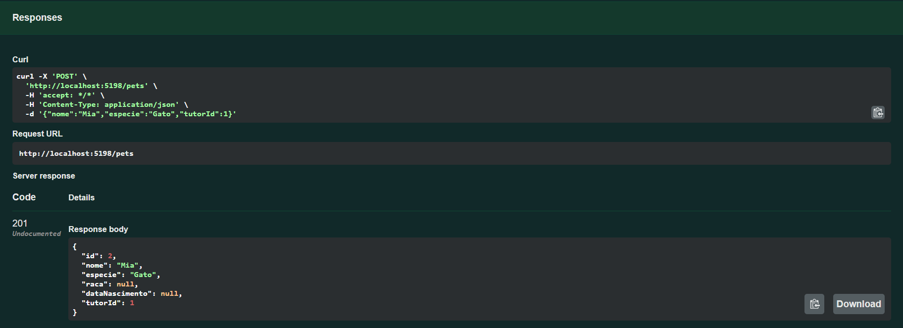

**GET `/pets`** — lista pets (200)

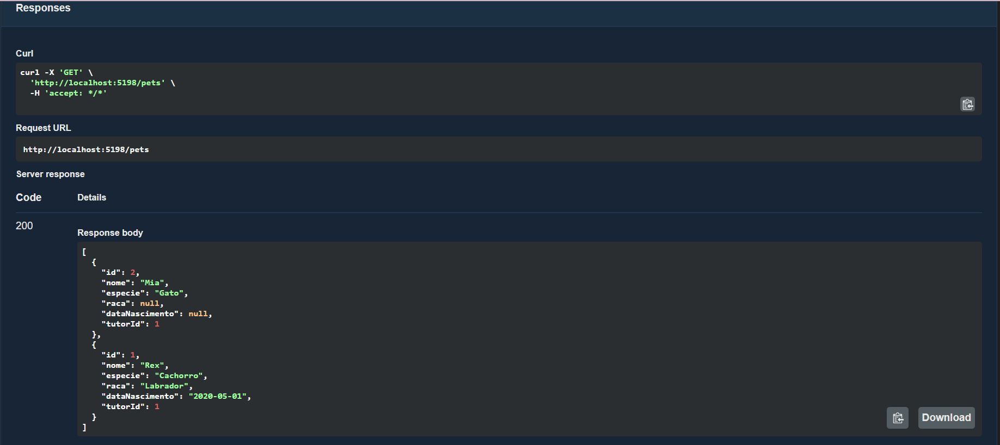

**GET `/pets/{id}`** — busca pet por id (200)

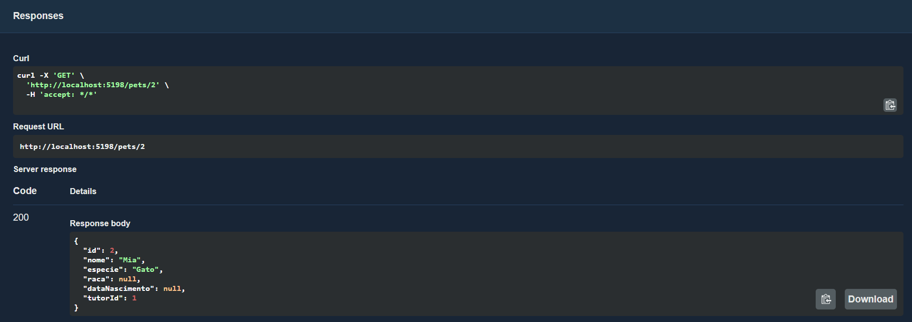

**PUT `/pets/{id}`** — atualiza pet (200)

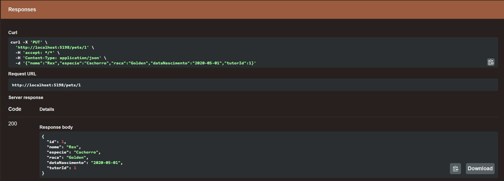

**GET `/pets/{id}/agendamentos`** — lista os agendamentos de um pet (200)

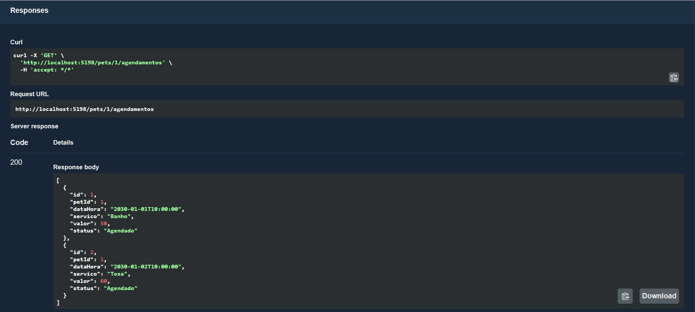

**DELETE `/pets/{id}`** — remove pet sem agendamentos (204)


### Agendamentos

**POST `/agendamentos`** — agenda um serviço (201)

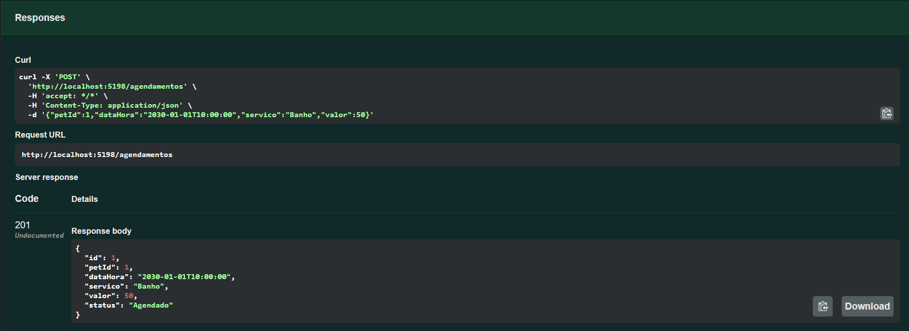

**POST `/agendamentos`** — agenda um segundo serviço (201)


**GET `/agendamentos`** — lista agendamentos (200)

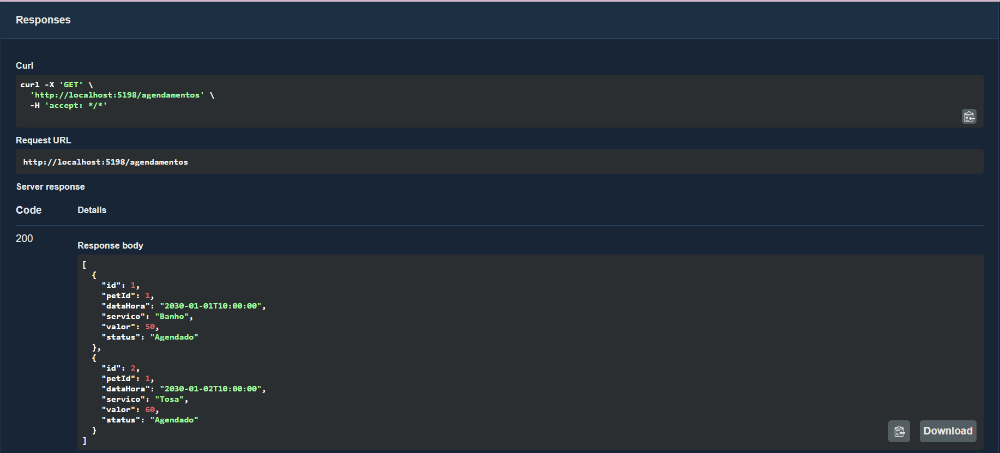

**GET `/agendamentos/{id}`** — busca agendamento por id (200)

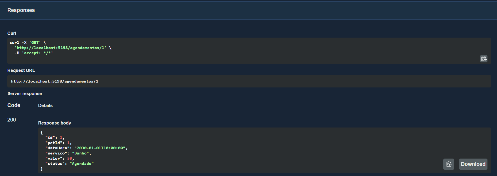

**PUT `/agendamentos/{id}`** — atualiza agendamento, incluindo o status (200)

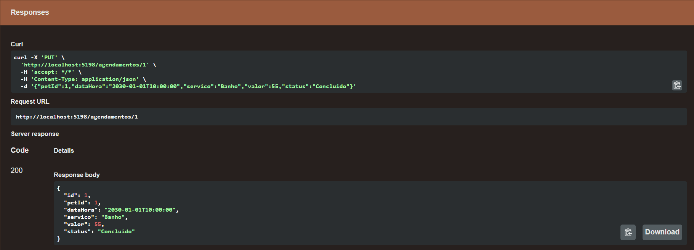

**DELETE `/agendamentos/{id}`** — remove agendamento (204)

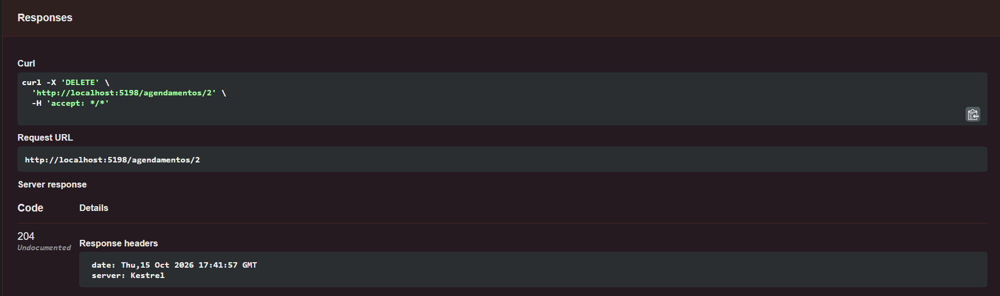

### Tratamento de erros

**POST `/tutores`** com dados inválidos — validação (400)

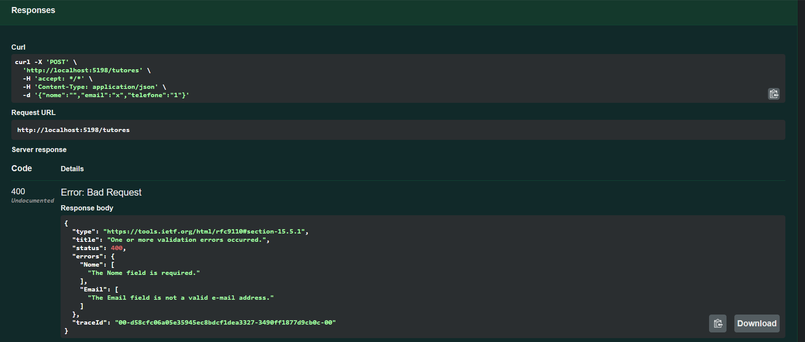

**POST `/tutores`** com e-mail já cadastrado (409)

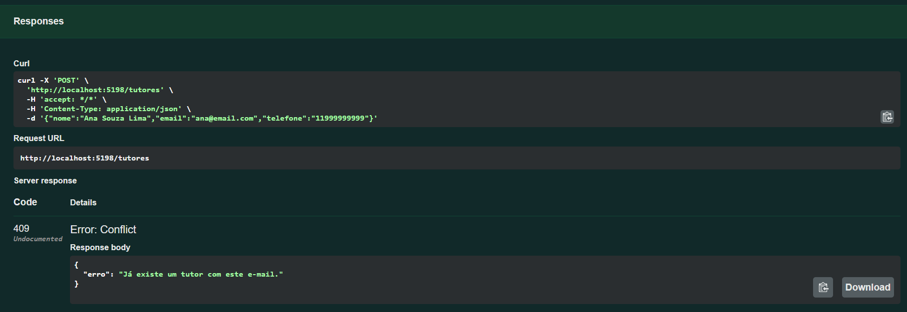

**POST `/pets`** com tutor inexistente (404)

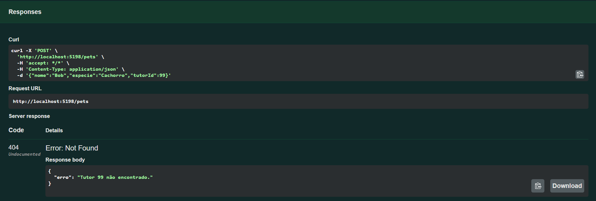

**POST `/agendamentos`** em horário já ocupado pelo pet (409)

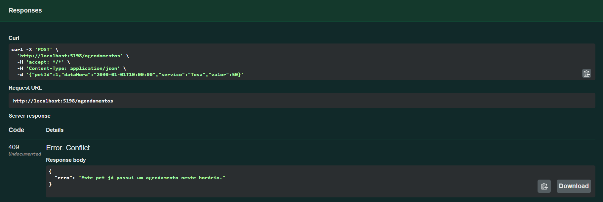
